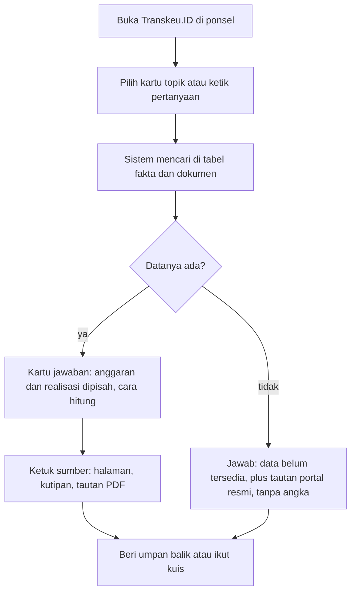

# PRD Transkeu.ID: Asisten Literasi Fiskal

22 Oktober 2026 · Nisaa. Versi hidup: [Claude Doc](https://claude.ai/artifact/Hj7WZ6UFTrreuaBRJoT8Pb)

## Ringkasan

Transkeu.ID versi awal adalah situs web ramah ponsel tempat warga bertanya tentang APBN dan mendapat jawaban sederhana yang selalu menyebut sumbernya. Contoh pertanyaan: "Berapa anggaran pendidikan, berapa yang sudah dipakai, dan untuk apa?"

Versi awal ini sengaja kecil agar bisa dibangun sebagai prototipe mahasiswa. Datanya hanya APBN pemerintah pusat dari beberapa dokumen resmi, tanpa APBD, akun pengguna, atau integrasi data otomatis. Gagasan lebih besar di naskah produk inovatif (integrasi seluruh laporan Kemenkeu, BPK dan Data.go.id, berita kebijakan, dasbor umpan balik publik) menjadi tahap lanjutan.

Prinsip utamanya: lebih baik menjawab "data belum tersedia" daripada memberi angka yang tidak bisa diperiksa.

## Masalah pengguna

Data anggaran negara sudah terbuka, tetapi sulit dipahami warga biasa. Naskah produk inovatif menyebut skor partisipasi publik Indonesia di Open Budget Survey 2023 hanya 31 dari 100, sementara skor transparansinya 66 dari 100.

1. **Dokumennya panjang dan teknis.** Nota Keuangan, UU APBN beserta lampirannya, dan LKPP berisi ratusan halaman tabel dengan istilah seperti pagu, outlook, realisasi, dan TKD.
2. **Angka mudah tertukar.** Anggaran (rencana) sering dikira realisasi (yang sudah dibelanjakan). Satuan juga berbeda-beda: miliar, triliun, atau persen.
3. **Satu topik tersebar di banyak dokumen.** Contohnya anggaran pendidikan: angkanya dialokasikan lewat belanja pemerintah pusat, transfer ke daerah, dan pembiayaan, jadi tidak muncul di satu tabel saja.
4. **Sulit menilai kebenaran informasi.** Angka yang beredar di media sosial jarang menyebut dokumen dan halaman sumbernya.

Catatan: naskah memakai Indeks Literasi Keuangan OJK 2022 (49,68%) sebagai gambaran. Indeks itu mengukur literasi keuangan secara umum, bukan literasi fiskal, sehingga pemahaman fiskal awal pengguna perlu diukur sendiri (lihat bagian Indikator).

## Sasaran pengguna

Pengguna utama versi awal adalah warga pembayar pajak dan mahasiswa yang ingin tahu ke mana uang negara dipakai, tetapi tidak terbiasa membaca laporan keuangan.

| Persona | Contoh | Kebutuhan utama | Contoh pertanyaan |
| --- | --- | --- | --- |
| Pekerja pembayar pajak | Karyawan swasta, 28 tahun, membaca berita lewat ponsel | Jawaban singkat yang bisa dipercaya | "Pajak saya dipakai untuk apa saja?" |
| Mahasiswa | Mahasiswa non-akuntansi yang mengerjakan tugas atau ikut diskusi | Angka plus sumber yang bisa dikutip | "Berapa anggaran kesehatan 2026 dan sudah terpakai berapa?" |
| Guru atau penggerak komunitas | Guru PKn atau pengelola komunitas literasi | Penjelasan istilah dan contoh untuk mengajar | "Apa beda anggaran pendidikan dengan anggaran Kemendikdasmen?" |

Bukan sasaran versi awal: analis profesional, jurnalis data, dan pegawai pemerintah yang butuh data mentah lengkap.

## Tujuan produk

Tujuan versi awal: membuktikan bahwa warga awam bisa menjawab pertanyaan dasar tentang APBN dengan benar setelah memakai Transkeu.ID, dan bisa menunjukkan sumbernya.

1. **Menjelaskan.** Mengubah angka dan istilah APBN menjadi penjelasan berbahasa sederhana.
2. **Bisa diperiksa.** Setiap angka dalam jawaban dapat ditelusuri ke dokumen resmi, halaman atau tabel, dan tautannya.
3. **Membedakan.** Pengguna paham beda anggaran, realisasi, dan outlook, termasuk satuan dan periodenya.
4. **Jujur soal batas.** Sistem menyatakan dengan jelas jika datanya tidak ada, alih-alih menebak.

Bukan tujuan versi awal: menilai kebijakan atau memberi opini politik; menggantikan portal resmi; memantau anggaran secara real-time atau menghubungkan data dengan berita.

## Ruang lingkup versi awal

APBN pemerintah pusat TA 2026 (anggaran dan realisasi berjalan) dan 2025 (realisasi yang sudah diaudit), dengan enam topik.

| Masuk versi awal | Ditunda | Alasan ditunda |
| --- | --- | --- |
| APBN pusat TA 2025 dan 2026, sekitar 5 sampai 8 dokumen resmi | APBD provinsi dan kabupaten/kota | Ratusan pemda dengan format laporan berbeda |
| 6 topik: pendidikan, kesehatan, perlindungan sosial, infrastruktur, subsidi energi, penerimaan pajak | Semua fungsi dan seluruh K/L | Perlu tabel fakta yang jauh lebih besar |
| Pembaruan data manual oleh tim | Integrasi otomatis dengan Kemenkeu, BPK, Data.go.id | Butuh kerja sama dan akses API resmi |
| Tanya jawab, kartu topik, kamus istilah, kuis singkat | Visualisasi interaktif lanjutan, berita terkait, dasbor umpan balik publik | Di luar kemampuan prototipe |
| Situs web responsif, tanpa login | Aplikasi Android/iOS, akun pengguna | Tidak perlu untuk menguji manfaat inti |
| Bahasa Indonesia | Bahasa daerah dan Inggris | Fokus satu bahasa dulu |

Catatan teknis (tidak mengikat): satu aplikasi web, satu basis data kecil untuk tabel fakta, indeks pencarian PDF yang menyimpan nomor halaman, dan satu layanan model bahasa lewat API.

## Fitur utama

F1 dan F2 adalah inti produk dan wajib selesai lebih dulu; F3 sampai F6 menyusul jika waktu cukup.

| No | Fitur | Cerita pengguna | Kriteria penerimaan |
| --- | --- | --- | --- |
| F1 | Tanya Anggaran | Sebagai warga, saya ingin bertanya dengan bahasa sehari-hari agar paham angka APBN tanpa membaca dokumennya | Jawaban memakai format kartu jawaban; muncul dalam 10 detik di 4G; menolak pertanyaan di luar APBN dengan sopan |
| F2 | Kartu Sumber | Sebagai mahasiswa, saya ingin melihat dokumen asal angka agar bisa memeriksa dan mengutipnya | Setiap angka punya kartu sumber: nama dokumen, instansi, tahun, halaman atau tabel, kutipan teks, tautan ke dokumen asli |
| F3 | Kartu Topik | Sebagai pengguna baru, saya ingin ringkasan topik populer agar tahu harus mulai dari mana | 6 kartu topik; tiap kartu berisi anggaran, realisasi terakhir beserta tanggal posisinya, dan 3 pertanyaan contoh |
| F4 | Kamus Istilah | Sebagai warga awam, saya ingin arti istilah seperti pagu atau TKD | Sekitar 30 istilah; istilah di jawaban AI dapat diketuk untuk melihat artinya |
| F5 | Umpan Balik Jawaban | Sebagai pengguna, saya ingin melaporkan jawaban yang salah | Tombol "Membantu", "Tidak membantu", "Laporkan angka salah"; laporan masuk ke daftar periksa tim |
| F6 | Kuis Pemahaman | Sebagai pengguna, saya ingin menguji pemahaman saya | 5 soal pilihan ganda sebelum dan sesudah; skor tersimpan tanpa data pribadi |

Format kartu jawaban F1:

1. **Jawaban singkat**, 1 sampai 3 kalimat.
2. **Angka utama**, dengan label jenis angka (Anggaran, Outlook, atau Realisasi), periode atau tanggal posisi data, dan satuan.
3. **Cara menghitung**, hanya jika ada perhitungan, dengan rumus dan angka yang dipakai.
4. **Untuk apa dananya**, contoh program atau kegiatan yang disebut di dokumen.
5. **Sumber**, satu kartu sumber untuk setiap angka.
6. **Batasan**, satu kalimat tentang hal yang tidak tercakup, jika ada.

Contoh: untuk "Berapa anggaran pendidikan, berapa yang sudah digunakan?", kartu menampilkan Anggaran TA 2026 dan Realisasi s.d. tanggal tertentu sebagai dua baris terpisah, masing-masing dalam Rp triliun dan dengan sumbernya. Persentase penyerapan hanya muncul jika kedua angka mencakup komponen yang sama.

## Alur penggunaan

Pengguna bisa mendapat jawaban bersumber dalam tiga ketukan: buka situs, pilih atau ketik pertanyaan, lalu ketuk sumbernya.

## Kebutuhan data

Kumpulan kecil dokumen resmi yang dikurasi tangan, ditambah satu tabel fakta berisi angka yang sudah diperiksa dua orang.

| Dokumen | Penerbit | Jenis angka | Dipakai untuk | Tautan |
| --- | --- | --- | --- | --- |
| UU No. 17 Tahun 2025 tentang APBN TA 2026, beserta lampiran | Pemerintah dan DPR (JDIH BPK) | Anggaran | Pagu pendapatan, belanja, pembiayaan 2026 | [JDIH BPK](https://peraturan.bpk.go.id/Details/338666) |
| Nota Keuangan beserta APBN TA 2026 | Kementerian Keuangan | Anggaran, penjelasan | Rincian per fungsi dan komponen | Cari saat kurasi |
| Siaran pers kinerja APBN 2026, mis. SP-86/KLI/2026 (7 Juli 2026) | Kementerian Keuangan | Realisasi, Outlook | Realisasi semester I dan prognosis semester II 2026 | [SP-86](https://media.kemenkeu.go.id/getmedia/9c8114a8-b642-4d79-95ad-8adf144a7f59/SP-86-APBN-2026-Tetap-Sehat-Dukung-Pertumbuhan-Ekonomi-dan-Agenda-Prioritas-Nasional?ext=.pdf) |
| LKPP 2025, audited, opini WTP | Kementerian Keuangan, diperiksa BPK | Realisasi | Realisasi penuh 2025 | Cari saat kurasi ([berita WTP](https://www.djkn.kemenkeu.go.id/kanwil-jakarta/baca-berita/41995/Siaran-Pers-Menkeu-Apresiasi-Capaian-Opini-WTP-LKPP-2025-di-Tengah-Berbagai-Tantangan.html)) |

Sejak 2026, realisasi bulanan APBN KiTa beberapa kali dirilis hanya sebagai siaran pers ([Jawa Pos](https://jawapos.com/ekonomi/2604300446/batal-gelar-konferensi-pers-kemenkeu-era-prabowo-perdana-sampaikan-realisasi-apbn-kita-lewat-siaran-pers)), jadi rincian realisasi per topik bisa tidak tersedia. Jawaban harus menyatakannya.

Tabel fakta, satu baris per angka yang boleh dipakai AI:

| Kolom | Contoh isi (ilustrasi format, bukan data) |
| --- | --- |
| topik | pendidikan |
| pos | Anggaran pendidikan, total |
| jenis_angka | Anggaran / Outlook / Realisasi |
| tahun_anggaran | 2026 |
| posisi_data | s.d. 30 Juni 2026 (khusus realisasi) |
| nilai, satuan | 123,4; Rp triliun |
| dokumen, penerbit | Nota Keuangan beserta APBN TA 2026; Kementerian Keuangan |
| halaman_atau_tabel | hlm. 4-12, Tabel 4.3 |
| kutipan | kalimat atau baris tabel asli |
| url | tautan langsung ke PDF |
| diperiksa_oleh, tanggal_periksa | dua nama, tanggal |

Pengolahan: setiap PDF dipecah per halaman dan nomor halamannya disimpan. Angka masuk tabel fakta secara manual oleh satu anggota tim, lalu dicek anggota lain. Target awal 60 sampai 100 baris untuk enam topik.

## Cara menjaga ketepatan jawaban AI

AI hanya boleh menyampaikan angka dari tabel fakta, dan semua perhitungan dikerjakan kode program, bukan model bahasa. Peran AI: memahami pertanyaan, memilih baris data, dan menjelaskannya dengan bahasa sederhana.

1. **Sumber wajib.** Angka tanpa baris tabel fakta tidak boleh tampil. Penjelasan non-angka harus mengutip potongan dokumen beserta nomor halamannya.
2. **Anggaran dan realisasi dipisah.** Selalu di baris berbeda dengan label jenis angka. Realisasi selalu disertai tanggal posisi data.
3. **Satuan jelas.** Rp triliun, Rp miliar, atau persen ditulis lengkap. Jika satuan dokumen berbeda, kode menyamakannya dan cara konversinya ditampilkan.
4. **Perhitungan ditampilkan.** Persentase realisasi = Realisasi s.d. tanggal / Anggaran (pagu) tahun yang sama × 100%. Kode hanya menghitung jika kedua angka punya tahun dan cakupan pos yang sama (realisasi belanja Kemendikdasmen tidak boleh dibagi total anggaran pendidikan).
5. **Tidak mengarang.** Jika data tidak ada: "Data ini belum tersedia di dokumen yang dimuat Transkeu.ID." lalu tautan ke portal resmi, tanpa angka perkiraan.
6. **Netral.** Tidak memberi penilaian kebijakan atau opini politik.

Pemeriksaan sebelum rilis, 50 pertanyaan uji dengan jawaban kunci (disusun bersama dosen pembimbing):

| Jenis pertanyaan uji | Jumlah | Syarat lulus |
| --- | --- | --- |
| Angka langsung (anggaran atau realisasi) | 20 | Angka, satuan, sumber benar di minimal 18 |
| Perhitungan (persentase, selisih) | 10 | Hasil dan cara hitung benar di minimal 9 |
| Istilah dan kegunaan anggaran | 10 | Penjelasan sesuai dokumen di minimal 9 |
| Data tidak tersedia atau di luar APBN | 10 | 10 dari 10 menyatakan "belum tersedia", tanpa angka karangan |

Setelah rilis: laporan "angka salah" dari F5 diperiksa setiap minggu; jawaban yang terbukti salah diperbaiki di tabel fakta dan ditambahkan ke daftar uji.

## Indikator peningkatan pemahaman pengguna

Uji coba dengan sekitar 30 responden: tes sebelum, sesi 15 sampai 20 menit memakai Transkeu.ID, lalu tes sesudah. Target adalah ambang yang ingin diuji, bukan hasil yang sudah terbukti.

| Indikator | Cara mengukur | Target uji coba |
| --- | --- | --- |
| Skor kuis pemahaman | 5 soal yang sama sebelum dan sesudah (F6) | Rata-rata naik minimal 1 soal |
| Bisa membedakan anggaran dan realisasi | Satu soal studi kasus | Minimal 80% benar setelah sesi |
| Bisa menemukan sumber | Tugas: tunjukkan dokumen dan halaman asal angka | Minimal 80% berhasil dalam 1 menit |
| Keyakinan diri | Skala 1 sampai 5 | Rata-rata naik minimal 1 poin |
| Jawaban dinilai membantu | Persentase "Membantu" dari umpan balik F5 | Minimal 70% |
| Ketepatan jawaban | 50 pertanyaan uji | Semua syarat lulus terpenuhi |
| Kemudahan di ponsel | System Usability Scale (SUS) | Skor minimal 68 |

Data uji coba tidak menyimpan nama atau nomor identitas; responden mengisi persetujuan singkat.

## Kebutuhan tampilan ponsel

- **Satu kolom** untuk layar 360 px; tidak ada tabel yang perlu digeser ke samping.
- **Kolom tanya selalu terlihat** di bawah layar, dengan 3 tombol pertanyaan contoh.
- **Kartu sumber sebagai bottom sheet**; tautan dokumen asli dibuka di tab baru.
- **Mudah dibaca:** teks minimal 16 px, area sentuh minimal 44 x 44 px, kontras WCAG AA, label jenis angka tidak hanya dibedakan warna.
- **Ringan:** halaman pertama di bawah 1 MB, tetap terbaca di 3G.
- **Tanpa login:** riwayat hanya disimpan di perangkat pengguna.

## Risiko, asumsi, dan pertanyaan terbuka

| Risiko | Dampak | Penanganan |
| --- | --- | --- |
| AI salah membaca atau mencampur angka | Informasi keliru | Angka hanya dari tabel fakta yang dicek dua orang; 50 pertanyaan uji |
| Rincian realisasi per topik tidak dipublikasikan | Pertanyaan "sudah dipakai berapa" tidak terjawab | Jawab "belum tersedia" dan tunjukkan realisasi terdekat dengan label jelas |
| Dokumen pindah alamat atau dihapus | Tautan sumber rusak | Simpan salinan PDF internal, cek tautan bulanan |
| Biaya API model bahasa | Prototipe berhenti saat kuota habis | Batasi pertanyaan per hari, simpan jawaban yang sering diulang |
| Pengguna mengira situs milik pemerintah | Salah persepsi | Tulis "proyek mahasiswa, bukan situs resmi pemerintah" di setiap halaman |

Asumsi: dokumen sumber tersedia dalam PDF yang teksnya bisa disalin, dan tim punya akses ke satu layanan model bahasa.

Pertanyaan terbuka:

- [ ] Siapa pemeriksa kedua tabel fakta: dosen pembimbing atau sesama mahasiswa Akuntansi Sektor Publik?
- [ ] Di mana LKPP 2025 versi audited bisa diunduh publik, dan apakah halamannya bisa dikutip?
- [ ] Apakah "anggaran pendidikan" dijawab sebagai total atau dirinci per komponen sejak versi awal?
- [ ] Responden uji coba diambil dari mana, dan kapan jadwalnya?

## Sumber

- Ridho Rambu Bassae, *Transkeu.ID: Inovasi Platform Transparansi Keuangan Publik Berbasis Artificial Intelligence*, Naskah Produk Inovatif, UNJ (`docs/sumber/`).
- [UU No. 17 Tahun 2025 tentang APBN TA 2026](https://peraturan.bpk.go.id/Details/338666), JDIH BPK.
- [Siaran Pers SP-86/KLI/2026](https://media.kemenkeu.go.id/getmedia/9c8114a8-b642-4d79-95ad-8adf144a7f59/SP-86-APBN-2026-Tetap-Sehat-Dukung-Pertumbuhan-Ekonomi-dan-Agenda-Prioritas-Nasional?ext=.pdf), Kemenkeu, 7 Juli 2026.
- [Menkeu Apresiasi Capaian Opini WTP LKPP 2025](https://www.djkn.kemenkeu.go.id/kanwil-jakarta/baca-berita/41995/Siaran-Pers-Menkeu-Apresiasi-Capaian-Opini-WTP-LKPP-2025-di-Tengah-Berbagai-Tantangan.html), DJKN, Juli 2026.
- [Realisasi APBN KiTa lewat siaran pers](https://jawapos.com/ekonomi/2604300446/batal-gelar-konferensi-pers-kemenkeu-era-prabowo-perdana-sampaikan-realisasi-apbn-kita-lewat-siaran-pers), Jawa Pos, 30 April 2026.
